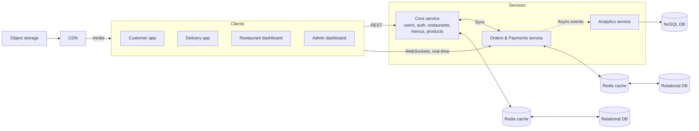

# QuickBite Architecture

QuickBite is a multi-region food ordering and delivery platform. This document explains the system design, the services, and the reasons behind each choice.

## Table of Contents
- [Overview](#overview)
- [Architecture Diagram](#architecture-diagram)
- [Clients](#clients)
- [Services](#services)
- [Data Layer](#data-layer)
- [Communication](#communication)
- [Media Delivery](#media-delivery)
- [Deployment](#deployment)
- [Scale Targets](#scale-targets)
- [Design Decisions](#design-decisions)

## Overview

The system has four types of clients and three backend services. Each service owns its own data. Services talk in two ways:

- **Sync** (request/response) for data that is needed right now.
- **Async** (events through a message broker) for work that can happen later.

## Architecture Diagram

> For the detailed drawing, see [`docs/architecture/architecture.svg`](docs/architecture/architecture.svg).

## Clients

| Client | Used by | Main job |
|---|---|---|
| Customer app | Customers | Browse menus, place orders, track delivery |
| Delivery app | Delivery agents | Accept deliveries, update status |
| Restaurant dashboard | Restaurant staff (RBAC) | Manage menus, accept and prepare orders |
| Admin dashboard | Platform admins | Manage users, restaurants, and reports |

## Services

### Core service
Handles users, authentication, restaurants, menus, and products.
- Read-heavy, so it sits behind a Redis cache.
- Stores data in a relational database.

### Orders & Payments service
Handles the order lifecycle and payments.
- Sends real-time updates to clients over WebSockets.
- Calls the Core service (sync) to check users, menus, and prices.
- Publishes events (async) when an order changes state.
- Has its own relational database and Redis cache.
- Data is sharded by region, with archive shards for old orders.

### Analytics service
Builds reports and metrics from order events.
- Consumes events from the message broker.
- Writes to a NoSQL database, which suits flexible, write-heavy data.
- Never blocks the order flow.

## Data Layer

| Store | Used by | Why |
|---|---|---|
| Relational DB (Core) | Core service | Strong consistency for users, menus, and relations |
| Relational DB (Orders) | Orders & Payments | ACID transactions for orders and payments |
| Redis | Core and Orders | Fast reads, lower load on the databases |
| NoSQL DB | Analytics | Flexible schema and fast writes for event data |
| Object storage | Media | Cheap storage for images and files |

Each service has its **own database**. No service reads another service's tables.

## Communication

| Type | Where | Why |
|---|---|---|
| Sync (REST) | Core <-> Orders | The answer is needed immediately |
| Async (events) | Orders -> Analytics | Keeps services loosely coupled and the order flow fast |
| WebSockets | Clients <-> Orders | Live order and delivery status |

## Media Delivery

Images are stored in an object storage bucket. A CDN sits in front of it. Clients load media from the CDN, so the backend services do not serve static files.

## Deployment

- Runs on AWS ECS Fargate.
- ALB with path-based routing sends traffic to each service.
- RDS (Postgres), ElastiCache (Redis), DocumentDB (Mongo-compatible), and Amazon MQ (RabbitMQ) are managed services.
- Secrets are kept in AWS Secrets Manager.
- CI/CD runs on GitHub Actions with OIDC.

## Scale Targets

| Metric | Target |
|---|---|
| Monthly active users | ~1M |
| Daily active users | ~200k |
| Average load | ~62 RPS |
| Peak load | ~620 RPS |
| Read / write ratio | 85 / 15 |

Load tests were run with k6 against the peak target.

## Design Decisions

1. **Separate Orders from Core.** Orders have different load, consistency, and scaling needs than the catalog.
2. **Cache in front of each database.** Most traffic is reads, so this cuts latency and database cost.
3. **Events for analytics.** If Analytics is slow or down, orders still work.
4. **Shard orders by region.** It keeps data close to users and keeps tables small.
5. **CDN for media.** It lowers latency and removes file traffic from the services.

## Known Trade-offs

- Sync calls between Core and Orders add coupling. If Core is down, order creation can be affected.
- Async events mean analytics data is eventually consistent.
- Several data stores mean more to operate and monitor.
